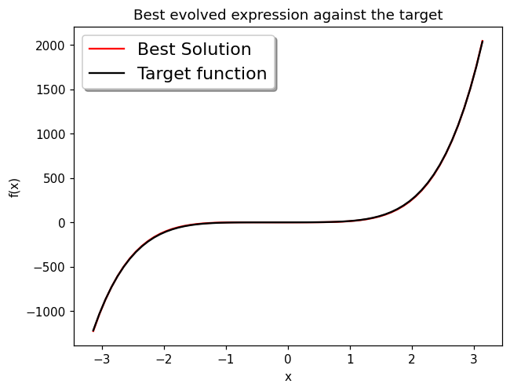
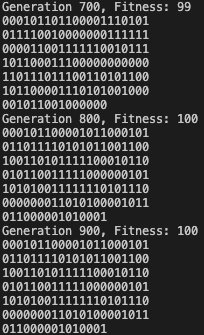
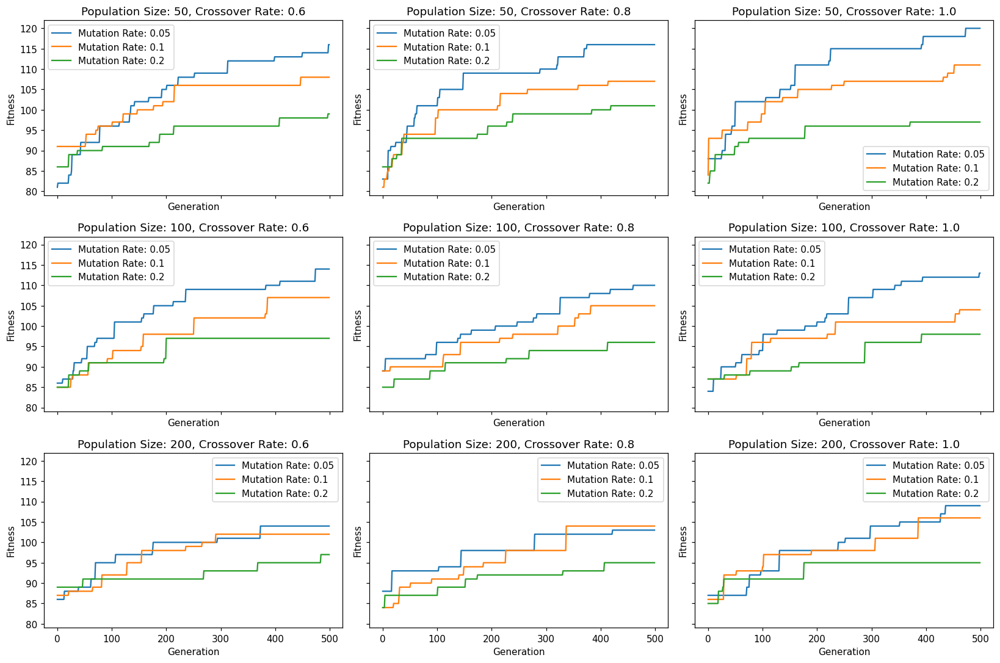
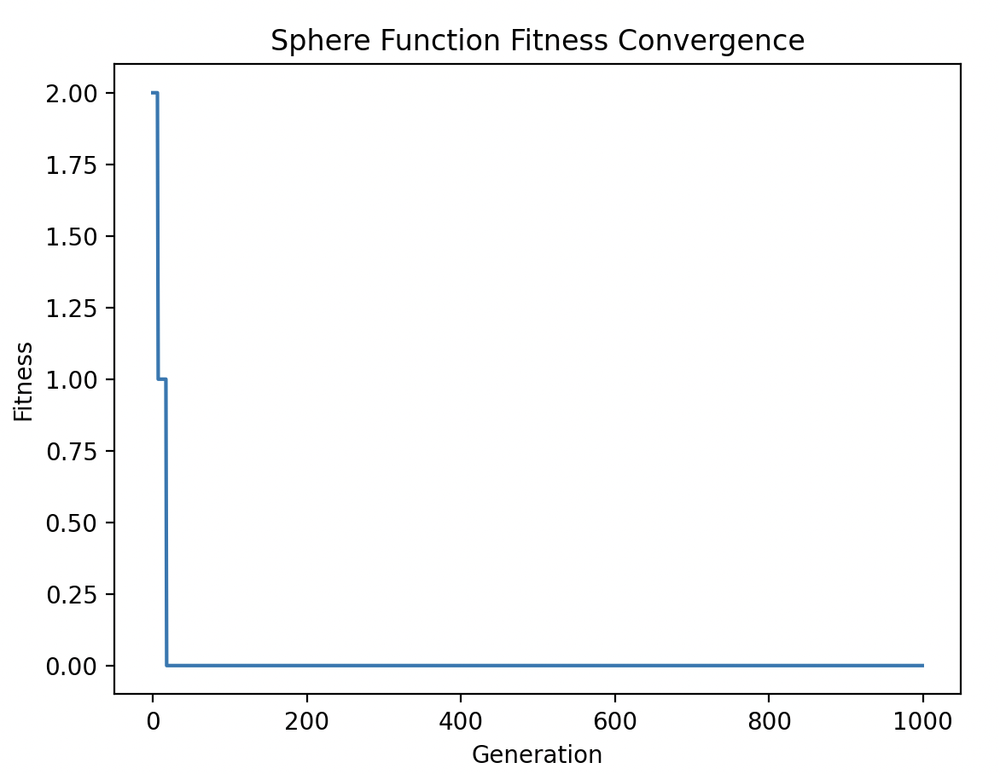
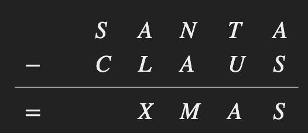
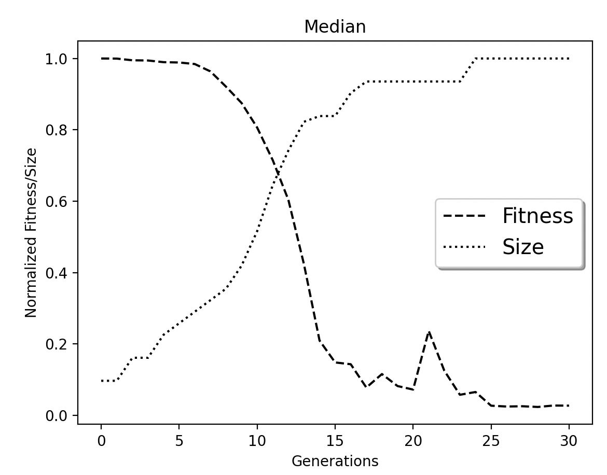

# Genetic Algorithms and Genetic Programming in Python

A steady state genetic algorithm I wrote from scratch and used on four problems, plus a genetic programming project built on DEAP that evolves maths expressions to fit a target curve. Everything is plain Python with numpy and matplotlib for the plots.



## What it does

The first half is my own genetic algorithm library and four things I pointed it at.

- **ASCII art.** Evolves a 141 bit binary string until it matches a target picture printed 21 characters wide. Fitness is the number of bits that match.
- **Hyperparameter sweep.** Runs the ASCII art GA with every combination of three population sizes, three crossover rates and three mutation rates (27 runs of 500 generations) and plots the fitness curves side by side.
- **Binary optimisation demo.** Minimises the Sphere function in 10 dimensions and the Rosenbrock function in 5 dimensions, with every variable restricted to 0 or 1. Both reach the exact minimum of 0.
- **The Santa Claus riddle.** Finds digits for the letters in SANTA minus CLAUS equals XMAS, with every letter standing for a different digit.

The second half is symbolic regression with genetic programming. The GP grows expression trees out of add, subtract, multiply, protected divide, negate, sin, cos and small constants until the tree fits 65 sample points from a target function. There are three targets to choose from: a fifth order polynomial, a sine wave, and a quadratic with a sine term added.

## My role

Solo project. I wrote the GA library and the four scripts that use it, designed the representation and fitness function for each problem, ran the parameter sweep, and wrote and ran the GP experiments on top of DEAP. After the first round of results I improved the GA so the ASCII art and the riddle both solve fully. The details are below.

## How it works

### The steady state GA

Every generation picks two parents, makes two children with single point crossover, mutates them, and drops them into the population. The two worst individuals fall off the end. The population is kept sorted so the best one is always at the front.

- **Selection** is a tournament of three: pick three at random and keep the best. I chose tournament over fitness proportional selection because tournament works the same whether you maximise or minimise.
- **Duplicates are rejected.** A child that is an exact copy of something already in the population is thrown away. Without this the population fills with clones of the best individual and stops exploring.
- **Direction** is a flag. The ASCII art maximises matching bits, the functions and the riddle minimise an error.

The same class is reused for every problem. Each script only overrides the parts that differ: how a random individual is made, how fitness is scored, and how mutation and crossover work when the genes are not plain bits.

### ASCII art

Each bit is one pixel. In my first runs I used a population of 200, crossover 0.8 and a mutation rate of 0.1 per bit, and the best string climbed from 85 matching bits at generation 0 to 100 by generation 800 before levelling off. A mutation rate of 0.1 flips around 14 bits in every child, which is too many once the string is nearly right, so I dropped it to 0.01 per bit and the GA matches all 141 bits in roughly 2500 to 3600 generations.



### Hyperparameter sweep

Population 50, 100 and 200, crossover 0.6, 0.8 and 1.0, mutation 0.05, 0.1 and 0.2, every combination for 500 generations. One subplot per population size and crossover rate, one line per mutation rate. With the first version of the GA the combination that came out best was population 200, crossover 0.8 and mutation 0.1. Running the sweep again with tournament selection, the lowest mutation rate finished highest in eight of the nine panels, which agrees with what I found on the ASCII art. The one exception was population 200 with crossover 0.8, where mutation 0.1 ended on 104 against 103.



### Sphere and Rosenbrock (binary optimisation demo)

This is a binary optimisation demo, not continuous optimisation. The individuals are binary strings and every variable is either 0 or 1, so the GA is searching over bit patterns for the one that minimises each function. Sphere is the sum of squares and has its minimum at all zeros. Rosenbrock is the sum of 100 (x[i+1] minus x[i] squared) squared plus (1 minus x[i]) squared and has its minimum at all ones. With population 100, crossover 0.8 and mutation 0.1 the GA finds both minima with a fitness of exactly 0 inside 1000 generations.



### The Santa Claus riddle



An individual is an ordered list of nine different digits, one per letter, with one digit left unused. Fitness is the absolute difference between SANTA minus CLAUS and XMAS, so zero means solved. To keep the digits unique, crossover copies the start of one parent and fills the rest from the other parent in order without repeats, and mutation either swaps two letters or swaps one letter for the unused digit.

This landscape is full of near misses that can trap a population, so I added a restart rule: if the best score has not improved for 400 generations the population is thrown away and started again, with the best mapping seen so far kept to one side. Each attempt takes a fraction of a second, so even a dozen restarts is only a few seconds. A solved run prints the mapping and the three numbers so you can check it, for example SANTA 24804, CLAUS 15462, XMAS 9342.

### Symbolic regression with genetic programming

The GP uses DEAP's eaSimple loop with a population of 500, 30 generations, tournament selection of size 5, crossover probability 0.7 and mutation probability 0.3. Fitness is the mean squared error between the tree and the target over 65 evenly spaced points from minus pi to pi. Trees start one or two levels deep and are built from add, sub, mul, neg, cos, sin, a protected divide that returns 1 on a zero denominator, the constants 1 and minus 1, and a random constant between minus 1 and 1.

Every generation prints the median, mean, min, max and standard deviation of both fitness and tree size, and the run ends with three plots: the dataset, the median fitness and size over the generations, and the best tree drawn over the target. In my recorded run on the polynomial, 12,320 evaluations brought the median fitness down from about 307,586 to about 7,202 while the median tree size grew from 3 to 31 nodes.



What I took from the GP runs: a bigger population is what matters most, because a small one loses diversity and extra generations stop helping, and runs with the same settings vary a fair bit because crossover and mutation are random, so one run is never enough to judge a configuration.

## How to run it

You need Python 3 and the three packages in `requirements.txt`.

```bash
pip install -r requirements.txt
```

The GA scripts live in `ga/` and import the library from the same folder, so run them from inside it.

```bash
cd ga
python3 steady_state_ga.py
python3 hyperparameter_analysis.py
python3 fitness_functions.py
python3 santa_riddle.py
```

The sweep takes a few minutes. The others finish in seconds. Plots open in a window and the script carries on when you close it.

The GP script asks which target you want and takes the generations, population size and tournament size as optional arguments, in that order.

```bash
cd gp
python3 symbolic_regression_gp.py
python3 symbolic_regression_gp.py 50 1000 7
```

## What's in this repo

- `ga/steady_state_ga.py` the GA library, and the ASCII art demo when run directly.
- `ga/hyperparameter_analysis.py` the 27 run parameter sweep with its plots.
- `ga/fitness_functions.py` Sphere and Rosenbrock minimisation over binary valued variables.
- `ga/santa_riddle.py` the riddle solver.
- `gp/symbolic_regression_gp.py` the DEAP genetic programming script.
- `media/figures/` the result plots and screenshots from my runs.
- `requirements.txt` the three packages needed.

## Demo video

Google Drive link: (add link here)

The full project report is available on request.

Copyright 2026 Mustafa Khodir. All rights reserved.
